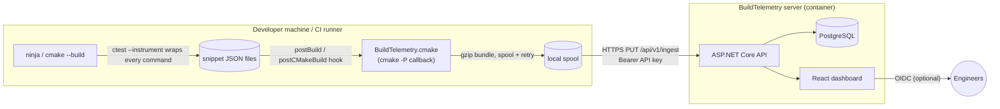

# CMake Build Telemetry

Plug-and-play build telemetry for CMake/Ninja C++ builds and a dashboard to analyse build
performance across many machines and down to a single build.

* **Client** – one CMake file, [`client/BuildTelemetry.cmake`](client/BuildTelemetry.cmake).
  It uses CMake's native [instrumentation](https://cmake.org/cmake/help/latest/manual/cmake-instrumentation.7.html)
  (CMake ≥ 4.3) to time every configure / compile / link / custom step. It adds system
  information and uploads a compressed bundle. It never fails or slows a build down in any
  noticeable way, and it can be disabled with a CMake option or an environment variable.
* **Server** – ASP.NET Core API (.NET 9/10) with PostgreSQL storage, ingest API keys,
  optional OIDC single sign-on, OpenTelemetry, health probes and OpenAPI.
* **Dashboard** – React + TypeScript + Mantine + ECharts, served by the same container.
  It covers fleet KPIs and trends, a build list, a per-build timeline (Gantt) with command
  lines, a machine and hardware-profile comparison with a normalized *speed index*,
  translation-unit and target hotspots, and a build-to-build comparison.



## Quick start

**1. Run the server** with Docker Compose (PostgreSQL included). It uses the published image
`ghcr.io/julianoberhaensli/cmake-build-telemetry` (linux/amd64 + linux/arm64), so you only need
two files, not the repository:

```bash
mkdir build-telemetry && cd build-telemetry
curl -fsSLO https://raw.githubusercontent.com/julianoberhaensli/cmake-build-telemetry/main/deploy/docker-compose.yml
curl -fsSL -o .env https://raw.githubusercontent.com/julianoberhaensli/cmake-build-telemetry/main/deploy/.env.example
# edit .env: set POSTGRES_PASSWORD and INGEST_API_KEY
docker compose up -d            # → http://localhost:8080
# evaluate without real builds first:  DEMO_DATA=true docker compose up -d
```

Image tags: `latest` (newest `main`), `sha-<commit>`, and `1.2.3` / `1.2` for release tags `v1.2.3`.
Pin one with `BT_IMAGE` in `.env` for production. To build the image from source instead, run
`docker compose -f docker-compose.yml -f docker-compose.build.yml up -d --build` in `deploy/`
of a checkout. Kubernetes: [`deploy/kubernetes/build-telemetry.yaml`](deploy/kubernetes/build-telemetry.yaml).

**2. Connect a project.** Add one line, or none at all; see "Connect builds" in the dashboard:

```cmake
# top-level CMakeLists.txt
include(cmake/BuildTelemetry.cmake)   # download from http://<server>/api/v1/client/BuildTelemetry.cmake
```

```bash
export BUILD_TELEMETRY_TOKEN=<INGEST_API_KEY>
cmake -S . -B build -G Ninja && ninja -C build    # appears in the dashboard seconds later
```

Other ways to connect, without editing the project:

```bash
# per configure (CMake ≥ 3.24 for the include hook)
cmake -S . -B build -G Ninja -DCMAKE_PROJECT_TOP_LEVEL_INCLUDES=/path/BuildTelemetry.cmake \
      -DBUILD_TELEMETRY_URL=https://build-telemetry.example.com

# whole machine / CI image: every CMake ≥ 4.3 build of this user
cmake -DBUILD_TELEMETRY_URL=https://build-telemetry.example.com -P BuildTelemetry.cmake install
```

**Disable** with `-DBUILD_TELEMETRY=OFF`, or set the environment variable `BUILD_TELEMETRY=OFF`
(also honoured: `DO_NOT_TRACK=1`).

## Guarantees of the client

| Requirement | How it is met |
|---|---|
| Never breaks the build | CMake < 4.3, an unsupported generator (Visual Studio, Xcode) or a missing endpoint: one status line, nothing else. All runtime operations are non-fatal, and CMake ignores the callback's exit code (verified). |
| Old `cmake_minimum_required` | Policies are scoped inside the module, so a project with `cmake_minimum_required(VERSION 3.16)` works unchanged (tested with CMake 3.22, 3.28, 4.2, 4.4). |
| Server unreachable | Bundles stay in a per-build-tree spool and are retried with exponential back-off (1 min … 1 h). The spool is capped (50 bundles, 14 days). |
| Minimal overhead | The client adds nothing to a `ninja` build: CMake runs the callback in its own background daemon after ninja has returned. With `cmake --build`, the blocking part only hard-links the snippet files and starts a detached uploader. CMake's own per-command wrapper is the dominant cost: **+5–6 %** measured on a Windows build of heavy translation units (more for tiny ones). See [docs/architecture.md](docs/architecture.md#3-performance). |
| Disable | `-DBUILD_TELEMETRY=OFF` removes the instrumentation query. `BUILD_TELEMETRY=OFF` / `DO_NOT_TRACK=1` in the environment skips collection at configure and build time. |
| Privacy | The OS user is hashed. Detail levels are `full`, `nocommands` and `summary`, plus `ANONYMIZE` (hashed host, `$SRC`/`$BUILD` placeholders). Source code is never read. |

## Repository layout

| Path | Content |
|---|---|
| `client/BuildTelemetry.cmake` | The client (project mode, machine mode, callback, uploader, management commands) |
| `server/` | .NET solution: `src/BuildTelemetry.Api` (API + static dashboard host), `tests/` (unit + PostgreSQL integration tests) |
| `dashboard/` | React SPA (Vite) |
| `deploy/` | Docker Compose, `.env.example`, Kubernetes manifests |
| `samples/demo-project/` | Small C++ project wired with the client (used by the end-to-end test) |
| `tests/e2e/run.sh` | Real CMake build → client → server → API assertions |
| `docs/` | [Architecture](docs/architecture.md) · [Client reference](docs/client.md) · [Server & operations](docs/server.md) · [Bundle format](docs/bundle-format.md) |

## Development

```bash
# server (needs a PostgreSQL; the database is created on first start if the user may)
cd server/src/BuildTelemetry.Api
ConnectionStrings__Postgres="Host=localhost;Database=buildtelemetry;Username=postgres;Password=…" \
Telemetry__Demo__Seed=true dotnet run          # http://localhost:5080 (see launchSettings) or ASPNETCORE_URLS

# dashboard with hot reload, proxying /api to the server
cd dashboard && npm install && npm run dev      # http://localhost:5173

# tests
cd server && BT_TEST_POSTGRES="Host=localhost;Username=postgres;Password=…" dotnet test
bash tests/e2e/run.sh                            # against a running server (BT_URL, BT_KEY)
```

> **.NET version.** The published image runs on .NET 10 LTS. Local development defaults to
> .NET 9 (`dotnet build -p:BtTargetFramework=net10.0` switches), which reached end of support
> on **2026-11-10**. CI tests both.
